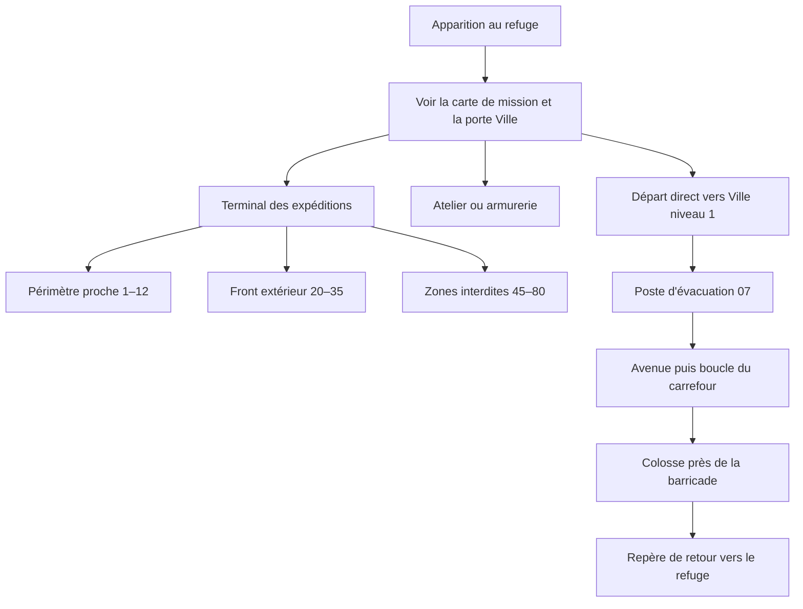

# Concept — refuge de départ, réseau de portails et première zone

> Brief de conception seulement. Ce document ne change ni la scène Roblox, ni les scripts, ni les modèles. Les noms, parcours et placements ci-dessous sont des propositions à valider avant toute modélisation.

## Intention

Faire comprendre en quelques secondes où le joueur se trouve, où acheter ses premières améliorations et comment partir combattre. Le refuge devient un camp de survivants organisé autour d'un axe lisible. La Ville niveau 1 est sa grande sortie principale ; les huit autres destinations sont rangées dans un terminal de départ par palier de danger. Une fois le portail franchi, la première zone raconte une petite expédition complète, avec un début, des repères, une boucle de combat et un retour évident.

## Constat sur la scène actuelle

- Le joueur apparaît près de `(0, 1, 220)` et la Ville niveau 1 est directement devant lui, près de `(0, 4.5, 208)`. Cette porte mérite de rester la destination la plus visible du refuge.
- La cour du refuge couvre environ 240 × 132 studs, centrée près de `(16, 0, 295)`. Elle contient déjà une allée, des lampes, des bancs, des abris et des clôtures ; elle peut accueillir les fonctions secondaires sans bloquer l'axe de départ.
- Les portails ne forment pas encore un seul répertoire évident : six entrées sont alignées près de `Z=208`, tandis que Quarantaine, Barrage et Citadelle sont plus loin dans la cour près de `Z=252`.
- Les quatre boutiques (améliorations, armes, pets et Robux) existent déjà. La zone PVP est aussi dans la cour et doit rester visuellement distincte du parcours vers les portails.
- La première zone, Ville, est de niveau 1, centrée près de `(0, 0, -120)`, avec une arrivée près de `(0, 4, 10)`, six points d'apparition et trois types de zombies déjà définis.

Ces positions sont des repères issus de la scène observée, pas un plan de construction. Le modèle de scène et les collisions devront être revérifiés dans Studio avant d'en tirer des coordonnées définitives.

## Plan proposé pour le refuge

```text
                         [ TERMINAL DES EXPÉDITIONS ]
                  Palier proche | Front extérieur | Zones interdites
                                  │
[ ATELIER ] ─────── [ PLACE DU CAMP / APPARITION ] ─────── [ ARMURERIE ]
[ améliorations ]         tableau de mission                  [ armes ]
                                  │
                         [ GRANDE PORTE DE LA VILLE ]
                                  │
                    Allée sûre vers la première expédition

        [ coin pets et caisses ]                [ arène PVP balisée ]
        dans une alcôve calme                  séparée du chemin
```

Le plan est relationnel, pas à l'échelle. Garder l'apparition dégagée : depuis celle-ci, le joueur voit d'abord la porte de la Ville et un panneau de mission, puis les boutiques de côté. Le terminal des expéditions rassemble les portails avancés dans la cour. Les quatre boutiques se lisent comme une rue de camp, avec l'atelier d'améliorations et l'armurerie proches du trajet principal ; pets et caisses occupent une alcôve plus calme. L'arène PVP garde une entrée et un code couleur propres, sans croiser la sortie vers la Ville.

### Répertoire unique des neuf destinations

Conserver les identifiants, niveaux requis, destinations, retours, vérifications serveur et prompts actuels. Réorganiser seulement leur présentation et leur future implantation visuelle autour d'un terminal commun :

| Aile | Destinations | Niveaux | Lecture visuelle proposée |
| --- | --- | --- | --- |
| Périmètre proche | Ville, Usine, Laboratoire | 1, 5, 12 | Signalétique claire et éclairage le plus accueillant ; la Ville ressort comme porte principale du jeu. |
| Front extérieur | Port des cendres, Centrale foudroyée, Métro oublié | 20, 28, 35 | Marquages d'expédition, balises froides et silhouettes industrielles. |
| Zones interdites | Fosse de quarantaine, Barrage des noyés, Citadelle des cendres | 45, 60, 80 | Aile plus sombre et sécurisée, alertes rouges, barrières visibles et niveaux affichés avant l'interaction. |

Chaque destination doit avoir le même ordre d'information : nom, niveau requis, état accessible/verrouillé, puis commande d'interaction. Un joueur qui n'a pas le niveau voit quand même la destination et comprend le prochain objectif ; ne pas promettre une récompense chiffrée qui ne correspond pas aux règles du jeu. Garder une allée libre devant chaque groupe et une ligne de vue depuis l'entrée du terminal. Les portails retour dans les zones restent des sorties indépendantes, facilement repérables après le combat.

## Première zone : « Quartier des derniers jours »

Conserver la Ville actuelle et ses limites de gameplay. Lui donner une boucle visuelle et narrative plutôt que d'étendre artificiellement l'arène :

1. **Point d'arrivée — Poste d'évacuation 07.** Une entrée reconnaissable, une carcasse de bus ou un barrage d'urgence en repère, un panneau orienté vers la rue praticable. Le joueur sait immédiatement où regarder et dans quel sens avancer.
2. **Avenue abandonnée — apprentissage du combat.** Réutiliser l'axe de l'avenue existante. Donner de la place pour voir le Rôdeur et apprendre l'attaque, puis faire apparaître l'Affamé dans une petite ruelle latérale pour introduire sa vitesse.
3. **Carrefour de ravitaillement — petite boucle de combat.** Utiliser la rue transversale comme boucle courte autour d'une épicerie ou pharmacie barricadée et de véhicules abandonnés. Les repères au sol et les barrières guident le joueur sans lui fermer le passage.
4. **Point de tension — poids lourd ou barricade effondrée.** Un passage plus étroit et une silhouette sonore annoncent le Colosse. Le décor raconte le danger ; il ne doit pas coincer le joueur ni masquer les attaques préparées.
5. **Retour — ligne d'évacuation.** Un faisceau, des balises ou le portail de retour ramène clairement vers l'entrée. Éviter une fausse sortie ou plusieurs chemins morts lors de cette première partie.

Les trois ennemis gardent leurs comportements, niveaux et récompenses actuels : Rôdeur comme menace de base, Affamé comme menace rapide, Colosse comme menace lente et résistante. Le décor peut enseigner leurs silhouettes et encourager une courte boucle, sans ajouter un boss, une mission, une ressource ou une nouvelle mécanique dans ce lot.

### Direction artistique

- **Refuge :** lumière chaude et stable au centre, bâches et signalétique de camp, éclairage de travail aux boutiques. La place doit rester lisible malgré l'ambiance nocturne du jeu.
- **Départ Ville :** le portail et le poste d'évacuation sont les seuls repères forts visibles depuis le joueur ; lumière froide de l'autre côté, contraste net entre sécurité et ruines.
- **Ville :** palette gris bleu, béton humide, rouille et quelques touches d'urgence orange/rouge. Les zones jouables restent éclaircies par des lampes, fenêtres ou la lampe torche ; les ombres décoratives ne doivent pas cacher les zombies, les bords de route ou les attaques.
- **Portails verrouillés :** montrer l'inaccessibilité sans faire croire à un bug : niveau requis lisible, silhouette visible, couleur de danger distincte et retour visuel au terminal.
- **Silhouette avant détail :** le joueur distingue une porte, une boutique, un ennemi et un chemin à distance avant de remarquer les petits accessoires.

## Parcours cible



## Brief prêt à transmettre au modèle qui fera la modélisation

> Reconcevoir le refuge de départ de Weapon Evolution et le décor de sa Ville niveau 1 en suivant `docs/ideas/REFONTE_REFUGE_ET_PREMIERE_ZONE.md`. Commencer par proposer un plan à l'échelle à partir de la scène Studio actuelle, puis modéliser après validation. Garder l'apparition dégagée, la Ville comme porte principale, les neuf destinations groupées par niveau dans un seul terminal, les quatre boutiques et l'arène PVP clairement séparées. Pour la Ville, construire la lecture autour d'un poste d'évacuation, d'une avenue, d'un carrefour de ravitaillement, d'un point de tension pour le Colosse et d'un retour lisible. Préserver les identifiants de zones, niveaux, limites, apparitions, interactions et retours. Ne pas ajouter de script, de mécanique, de paiement ou de système de progression. Vérifier la scène et ses dimensions dans Roblox Studio avant de proposer des coordonnées finales. L'éclairage reste nocturne mais doit laisser lire les chemins, les ennemis et les interactions. Ce document ne contient ni mesh, ni texture, ni modèle créé.

## Critères de revue avant modélisation

- Depuis l'apparition, la porte Ville et le panneau de mission sont identifiables immédiatement ; les boutiques se trouvent sans traverser l'arène PVP.
- Les neuf zones sont visibles dans un répertoire unique, regroupées par niveaux, avec les niveaux requis lisibles et les trois paliers avancés distingués.
- Les prompts et validations de niveau existants restent attachés aux mêmes identifiants et destinations ; le visuel du verrouillage ne remplace jamais le contrôle serveur.
- Le chemin d'arrivée de la Ville conduit naturellement à l'avenue, puis à une boucle autour du carrefour, sans impasse obligatoire.
- Depuis les principaux angles de combat, les zombies, les bords praticables et les attaques restent lisibles avec la lampe torche.
- Le retour vers le refuge se comprend sans rouvrir le menu ; les collisions, la zone sûre et l'arène PVP ne se chevauchent pas.
- PC, écran tactile paysage/portrait, manette et options de réduction des mouvements seront vérifiés quand l'implantation et l'UI seront réellement reprises.

## Portée et prochaine étape

Livré dans ce lot : concept, plan relationnel, organisation des neuf portails, parcours de première zone et brief pour la modélisation. La prochaine étape est une proposition de plan à l'échelle dans Studio, comparée à la scène courante et à ses limites de zone ; la modélisation vient seulement ensuite. Aucune scène, aucun script, aucun asset et aucune mécanique de jeu n'ont été modifiés.
